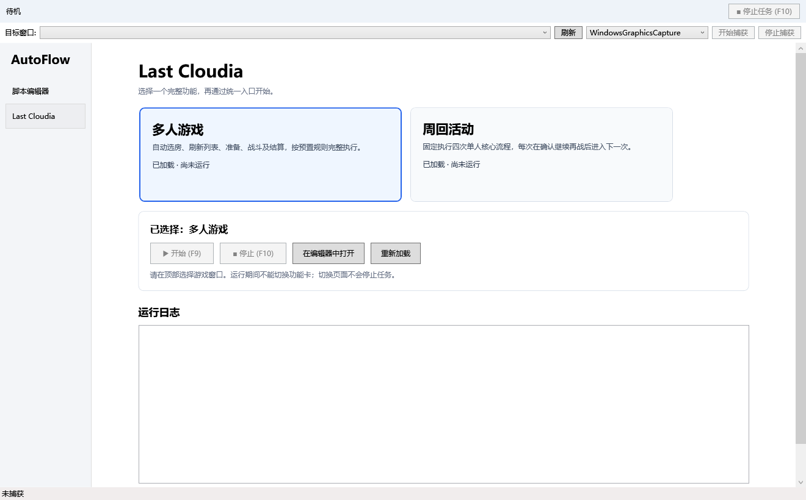

# Last Cloudia 周回活动验证记录

- 日期：2026-11-22
- 范围：[Spec](../features/week-round/Spec.md) / [Plan](../features/week-round/Plan.md)
- 结论：代码、资源、自动化测试、布局与仓库外发布资源检查完成；真实 Last Cloudia 操作待验收。

## 构建与测试

```powershell
dotnet test AutoFlow.Core.Tests/AutoFlow.Core.Tests.csproj -c Debug -p:Platform=x64 --no-restore
dotnet test AutoFlow.App.Tests/AutoFlow.App.Tests.csproj -c Debug -p:Platform=x64 --no-restore
dotnet build AutoFlow.sln -c Debug -p:Platform=x64 --no-restore
dotnet build AutoFlow.sln -c Release -p:Platform=x64 --no-restore
dotnet publish AutoFlow.App/AutoFlow.App.csproj -c Release -p:Platform=x64 --no-restore -o <仓库外临时目录>
```

- Core：339 项通过，7 项既有仓库迁移测试保持跳过。
- App/WPF：20 项通过。
- Debug：0 警告、0 错误。
- Release：0 错误；`Fischless.GameCapture` 保留已有 WinRT `Attach` API 的 CS0618 弃用警告 1 项，本功能未修改第三方捕获代码。
- 仓库外临时发布目录已确认包含 `AutoFlow.exe`、`WeekRound.json`、两张新增模板图片及公共技能图片。

新增自动化覆盖：单一顶层 CallSkill、流程技能恰好四次调用、固定参数、失败/取消停止、七分支优先级、两个退出位置、超过 1000 次继续循环、抓帧失败不点击且有等待、严格参数校验、间接条件/动作/文件预检、模块默认选择、运行锁定、规则/线性编辑器分派和预置副本隔离。

## 界面检查

使用真实 WPF XAML 渲染 1320×820 布局。两张功能卡完整显示，默认选中多人游戏，统一开始、停止、在编辑器中打开及重新加载入口可见；未选择目标窗口时开始按钮禁用。



## 验收映射

| 验收范围 | 自动化/静态证据 | 实机状态 |
|---|---|---|
| AC-01–02 | 预置脚本加载并验证；只有一个 `CallSkill(LastCloudia.WeekRound)`；C# 流程技能固定四次调用 | 待运行完整四次 |
| AC-03–04 | 单人核心分支、优先级、`again`/`last_step` 和退出位置测试通过 | 七种画面及未知状态待逐项观察 |
| AC-05–07、15–16 | 共享条件/动作/公共原语引用测试；新增资源坐标与 AHK 对照；无重复增加体力动作块 | 点击位置和等待节奏待观察 |
| AC-08–09、17–18 | 第四次后不发起第五次；失败、取消、超过 1000 次及抓帧失败测试通过 | F10、捕获短暂失败恢复待实机确认 |
| AC-10–13 | 缺失间接资源在输入前失败；副本和快照隔离；仓库外发布资源闭包通过 | 原生文件对话框及发布程序完整运行待手工确认 |
| AC-14、19 | 两张功能卡、统一入口、默认选择、运行锁定、1/4–4/4 状态与日志测试/布局通过 | 全局 F9/F10 与游戏前台行为待确认 |

## 实机验收清单

1. 选择“周回活动”，F9 与开始按钮均启动该模块；运行中不能切换卡片。
2. 分别观察队伍准备、体力恢复四次、战斗结算、再战确认、初次通关奖励、战斗评价奖励和最后结算。
3. 暂时遮挡、最小化或切换捕获状态，确认抓帧失败期间没有未知状态点击，恢复后继续。
4. 在每个长等待和单人核心循环阶段测试 F10，确认不会继续下一次调用。
5. 确认日志和状态从第 1/4 推进到第 4/4；第四次点击继续再战后任务完成，不进入第五次核心调用。
6. 记录实际坐标、DPI、等待节奏和第 4 次结束时游戏所在页面；若需要改变规范行为，先更新 Spec。

当前没有把上述实机项目记为通过。
